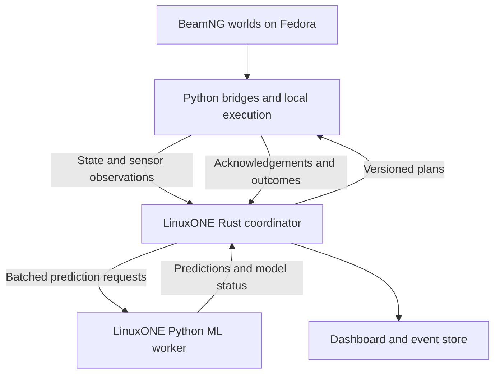

# Uriel — Product Requirements Document

**Version:** 1.0  
**Date:** 16 October 2026  
**Project:** Uriel  
**Event:** IBM Z Datathon 2026  
**Chosen theme:** Real-Time AI for Critical Decisions  
**Team:** Four members; two experienced developers and two beginners  
**Status:** Product and engineering specification; requirements and targets below are proposed, not completed capabilities or measured results.

## 1. Product definition

Uriel is a cooperative vehicle-safety and road-hazard coordination prototype. Connected vehicles send motion, route and sensor-derived observations to a shared server. The server predicts conflicts, uses models trained on BeamNG data to estimate vehicle behaviour, and coordinates feasible responses. Vehicles also share observations of unconnected traffic, road damage and blockages.

The prototype runs physics and sensors in BeamNG.tech on Fedora laptops. Its Rust coordination backend and Python ML inference execute on an Ubuntu s390x VM on IBM LinuxONE. A dashboard explains what the server sees, predicts and commands.

The product must support expansion from two vehicles at one intersection to multiple vehicle types, encounters and junctions. The team selects which scenarios to demonstrate during the event. This document preserves the entire requested scenario catalogue; implementation stages define dependencies rather than deleting later ideas.

**Product statement:** Uriel turns observations from individual vehicles into shared predictions and coordinated actions, then measures their effects in a physics-based simulation.

## 2. Problem and intended value

A vehicle acting only on its own state and observations has limited knowledge of other vehicles' intentions, hazards beyond its view and conflicts involving several road users. Independent avoidance decisions can also conflict: two vehicles may choose the same escape space, or an intersection scheduler may release a car before a long truck has cleared the crossing.

Uriel explores whether shared state, cooperative sensing and data-trained predictions can improve these decisions. Its initial setting is connected automated vehicles in a simulated, partially connected road environment. Applications of interest include managed intersections, industrial fleets, campuses and future cooperative transport infrastructure.

Potential societal benefits are fewer simulated collisions, smoother intersection passage, earlier road-hazard warnings and better treatment of vehicles whose size or dynamics differ. These benefits must be measured in the tested scenarios. A BeamNG result is not evidence that the system is ready for public-road control.

## 3. Confirmed context and decisions

| Area | Decision or current state |
|---|---|
| Project name | Uriel; replaces Arc Angel/ArcAngel and Sentinel |
| Simulation | BeamNG.tech and BeamNGpy on Fedora KDE laptops |
| Normal driving | BeamNG built-in AI where suitable, with a bridge for routes and commands |
| Coordination server | Rust with Axum and Tokio |
| ML | Existing learning algorithms trained on project-generated BeamNG data |
| ML runtime | Python process on LinuxONE; persistent model loaded in memory |
| Server | Ubuntu 24.04, s390x, 3 virtual CPUs, 8 GB RAM, 50 GB storage |
| Team access | One VM shared by the team; individual SSH keys |
| Existing lab environment | Docker container `ibm-ml-labs`; Jupyter reached through SSH forwarding |
| Initial telemetry | Vehicle positions, velocities and intended routes |
| Collaboration | Local development, versioned interfaces, reviewed integration and one deployment owner |
| Demonstration | Dashboard plus visible BeamNG intervention and recorded evidence |

The organizer meeting explicitly requested one server per team and emphasized original AI-based work demonstrated on LinuxONE. The supplied labs are reference material. This PRD does not infer the exact mandatory lab pair, individual completion policy or permitted pre-event coding from that meeting alone; the current written rules remain authoritative for those questions.

## 4. Users and operating modes

### 4.1 Users

- **Scenario operator:** Starts and resets scenarios, configures vehicles and records tests.
- **Coordination developer:** Implements tracking, predictions, scheduling and candidate manoeuvres.
- **Data/ML developer:** Generates labels, trains models, evaluates them and publishes model versions.
- **Evaluator or judge:** Sees the problem, intervention, deployed inference and measured result.
- **Future infrastructure or fleet operator:** A potential user beyond the datathon, not a deployment claim.

### 4.2 Modes

| Mode | Behaviour |
|---|---|
| Baseline | Configured normal driving; no Uriel intervention. Log all available evidence. |
| Observe-only | Uriel predicts and proposes actions but does not actuate them. |
| Algorithm-only | Geometric and rule-based planning without learned predictions. |
| Hybrid | The same planner consumes validated ML predictions on LinuxONE. |
| Fault injection | Deliberately introduce packet delay, lost observations, ignored commands or model outages. |
| Replay | Run saved telemetry through the backend without live BeamNG actuation. |

Every run must record its mode. Replays and generated load must be labelled separately from live physics tests.

## 5. Goals, boundaries and evidence

### 5.1 Product goals

1. Detect predicted conflicts before vehicle bodies overlap in supported scenarios.
2. Coordinate connected vehicles through shared space using feasible speed or path adjustments.
3. Track visible unconnected vehicles from connected vehicles' sensor observations.
4. Respect road elevation, vehicle dimensions, controller capabilities and state uncertainty.
5. Demonstrate useful server-side ML with a held-out evaluation and an algorithm-only comparison.
6. Share validated road hazards and blockages with approaching vehicles.
7. Explain interventions and degraded operation through logs and the dashboard.

### 5.2 Boundaries

- Uriel is a simulation research prototype. It does not guarantee collision avoidance in every physically possible situation.
- An unconnected vehicle cannot be commanded. Its motion is estimated from observations.
- An occluded object cannot be tracked without a usable prior track or an observer that can see it.
- A server decision is not assumed to be applied until the bridge acknowledges it and subsequent telemetry shows its effect.
- The server cannot replace a local emergency response when communications fail or arrive too late.
- The existence of IBM AI acceleration does not establish that a chosen model uses it. CPU inference is an acceptable initial implementation; hardware acceleration is a separately verified capability.
- Active suspension, airborne steering and jumping require explicit simulator and vehicle capability checks. They are not assumed to exist on ordinary vehicles.
- Novelty is the implemented combination, evidence and scenario coverage. Do not claim that V2X, cooperative perception or intersection coordination have never existed.

## 6. Scenario catalogue and acceptance requirements

The catalogue below captures the team's intended product scope. Each scenario must specify a map, initial conditions, vehicle configurations, observation mode, feasible action set and measurable outcome before being presented as supported.

### U-S01 — Two-vehicle 90-degree intersection

**Situation:** Two connected vehicles approach crossing routes with overlapping predicted occupation of the same conflict zone.

**Required behaviour:** Predict each vehicle's arrival and clearance times. Assign crossing order and request a bounded slowdown or hold from one vehicle. Update the plan as actual motion changes. Prefer passage without a complete stop when a feasible smooth solution exists.

**Inputs:** 3D pose, velocity, acceleration, route, vehicle dimensions, controller response and observation age.

**Acceptance:** On a declared set of feasible approaches, neither vehicle overlaps the other's swept body in the conflict zone, both eventually clear it, and the server records the reason for the chosen order. Report minimum clearance, delay, peak deceleration and jerk. Include a case that must stop and a case where no intervention is needed. Do not force smoothness when stopping is necessary.

### U-S02 — More vehicles and multiple intersections

**Situation:** Gradually increase traffic beyond the first two vehicles, then introduce adjacent intersections with interacting queues.

**Required behaviour:** Maintain per-zone reservations, prevent contradictory permissions, respect downstream space and bound repeated deferrals. Use route progress to connect successive conflict zones.

**Acceptance:** Advance through 2, 4, then 6–10 active vehicles as laptop performance permits. Test simultaneous arrivals, a stopped vehicle and an occupied exit. Record throughput, waiting times, starvation and deadlocks. Multiple intersections must not release a vehicle into a full downstream segment.

### U-S03 — Connected head-on encounter with obstacles

**Situation:** Two connected vehicles approach head-on. Obstacles or surrounding traffic constrain escape space.

**Required behaviour:** Evaluate braking and reachable lateral corridors, allocate compatible trajectories and verify full-body clearance. Coordinate both vehicles when both can respond.

**Critical interpretation:** “One goes left and one goes right” is not a fixed rule. Left and right are vehicle-relative; opposite headings make those descriptions ambiguous. The planner must select nonintersecting corridors in a shared world frame and translate them into each vehicle's controls.

**Acceptance:** Test clear shoulders, one blocked shoulder, neighbouring traffic and no feasible escape. Reject any corridor through an obstacle, off a bridge or outside the allowed surface. If the encounter is unavoidable at the tested distance, report that outcome and apply the selected feasible fallback rather than inventing an escape.

### U-S04 — Driver or controller non-response and controlled stop

**Situation:** A simulated human or automated controller fails to respond, or the vehicle begins departing its intended corridor.

**Required behaviour:** Detect a declared non-response signal or command-tracking failure, activate hazard lamps when supported, seek an available stopping corridor and decelerate within the scenario's reachable limits. Account for approaching rear traffic.

**Detection boundary:** The prototype can use a simulated driver-response flag, controller heartbeat, command acknowledgement and observed tracking error. These are not evidence that it diagnoses human unconsciousness or medical emergencies.

**Acceptance:** Inject a missed response and a steering deviation. Record detection time, control handoff, lane departure, stopping distance and collisions. Include cases where pulling over is blocked and where immediate braking is required. Hazard-lamp actuation is capability-gated and reported accurately.

### U-S05 — Unknown vehicle at a 90-degree intersection

**Situation:** A connected vehicle approaches an intersection while a second vehicle supplies no telemetry to Uriel.

**Required behaviour:** Build a track from LiDAR observations of one or more connected observers. Estimate motion over time, represent uncertainty and protect a sufficient occupancy window. Slow or stop the connected vehicle when conflict is predicted.

**Acceptance:** The online planner must not consume the unknown vehicle's simulator pose, velocity, route or object ID as hidden input. Use those only in an isolated evaluation stream. Test visible, partially occluded and temporarily lost tracks. Display the last observation age and uncertainty. The unknown vehicle receives no command.

### U-S06 — Unknown vehicle in a head-on encounter

**Situation:** An unconnected oncoming road user threatens a connected vehicle.

**Required behaviour:** Predict several plausible short-horizon motions where needed. Choose a reachable response for the connected vehicle only. Re-evaluate frequently instead of assuming the unknown vehicle will cooperate.

**Acceptance:** Test continuing, braking and changing-direction unknown vehicles. The plan must not rely on the other vehicle yielding. Include obstacle-limited corridors and a lost-track fallback.

### U-S07 — Rear-end threat

**Situation:** A following vehicle is closing rapidly on a connected vehicle.

**Required behaviour:** Estimate the closing threat and compare holding course, feasible acceleration, lateral escape and braking where appropriate. Include the forward gap, crossing traffic, road boundary and other vehicles in every candidate check.

**Acceptance:** Include a clear road ahead, a blocked road ahead, an occupied adjacent lane and no feasible avoidance. The system may accelerate only when it can maintain a forward clearance envelope. Measure both rear impact outcomes and any secondary conflict created by the response.

### U-S08 — Mixed vehicle types and long trucks

**Situation:** Cars, buses, trucks and supported motorcycle-like actors have different dimensions and dynamics. A long truck crosses an intersection or turns through it.

**Required behaviour:** Use actual configured dimensions and conservative dynamic limits. Keep reservations until the rear of the complete vehicle clears. For articulated vehicles, model the trailer and its swept path; do not represent a tractor-trailer as a small car at its centre point.

**Acceptance:** Show a crossing where the truck's front has left the conflict zone but its rear still occupies it; the next vehicle must remain held. Test turning off-tracking if articulated turning is claimed. Record model/configuration availability. A motorcycle test is contingent on an installed, functioning vehicle or explicitly labelled proxy; do not claim a car proxy validates motorcycle dynamics.

### U-S09 — Elevation, slopes, flyovers and stacked roads

**Situation:** Two vehicles overlap in a top-down view while travelling on separate road decks, or a route climbs or descends.

**Required behaviour:** Use 3D oriented bodies, road-segment connectivity and the predicted occupied volume over time. Distinguish separated decks without hiding genuine bridge-edge or falling-object threats.

**Acceptance:** A vehicle passing safely above another must not trigger a false intersection intervention. Vehicles entering the same ramp or physical volume must still be checked. Test sloped roads and tall vehicles. A single fixed altitude-difference threshold is insufficient as the full implementation.

### U-S10 — Airborne or falling vehicle threat

**Situation:** A vehicle jumps or falls from a bridge and may intersect another vehicle's future path.

**Required behaviour:** Begin with controlled jump tests. Estimate a 3D trajectory from observed position and velocity, predict a time-indexed occupied volume and move or hold the connected vehicle only if a reachable alternative exists.

**Model boundary:** A ballistic trajectory is an initial short-horizon approximation while airborne, not a guarantee. Rotation, body size, aerodynamic effects and impacts increase uncertainty. Re-estimate after new observations or contact. Maintain an explicit airborne state so road-deck filtering does not suppress this hazard.

**Acceptance:** Include an airborne vehicle passing above safely and another entering the connected car's occupied volume. Evaluate prediction error and response feasibility. Do not command instantaneous lateral motion or claim knowledge before an observation is available.

### U-S11 — Pothole detection, impact severity and shared map

**Situation:** A connected vehicle observes or traverses a pothole or rough-road patch.

**Required behaviour:** Associate an event with a road segment and position. Estimate geometric dimensions when sensor coverage supports them. Separately estimate the disturbance caused to a particular vehicle at a particular speed. Aggregate repeated reports into a hazard record with confidence and freshness.

**Inputs:** Local road surface estimates, vertical acceleration in a defined frame, roll/pitch response, speed, suspension response where available and vehicle configuration.

**Acceptance:** Place known defects in a controlled test scene and compare estimated location/size against evaluation geometry. Compare disturbance at multiple speeds and vehicle types. Do not infer pothole depth directly from one acceleration spike. Unobserved dimensions remain unknown. Report a normalized disturbance index rather than an unvalidated real-world danger probability.

### U-S12 — Blocked roads, unstable road surfaces and rerouting

**Situation:** A vehicle finds a blocked road or a segment that repeatedly causes excessive disturbance, then warns others.

**Required behaviour:** Publish a directional, road-level hazard with source, location, confidence and expiry. Update route costs or exclude a confirmed blocked edge. Share a route revision with approaching connected vehicles while retaining collision checks on the new route.

**Acceptance:** One observer reports a blockage; a later connected vehicle receives it and follows an available alternative. Test false reports, duplicates, stale hazards, opposite directions and a road under a flyover. A stopped vehicle alone is not sufficient evidence of permanent closure. If there is no route, hold and report that state rather than inventing a connection.

### U-S13 — Active-suspension or obstacle-jump experiment

**Situation:** Explore the proposed “jumpable obstacle” concept, including a vehicle-specific suspension-assisted manoeuvre if the simulator permits it.

**Required behaviour:** First establish that the chosen vehicle has a controllable mechanism capable of producing the requested motion. Evaluate takeoff, body clearance, landing surface, stability and the full landing corridor. Ordinary steering and suspension travel must not be treated as an arbitrary jump actuator.

**Acceptance:** This remains experimental until a capability test succeeds. A ramp-based jump may support trajectory experiments but must not be presented as active-suspension jumping. If a modified vehicle is used, identify its modifications and physical assumptions. Braking or ordinary avoidance remains available when a jump is unsupported or infeasible.

## 7. Architecture and responsibility split

### 7.1 Laptop bridge

- Own the connection to its BeamNG instance, collect state and apply accepted plans.
- Convert simulator coordinates into the protocol frame and attach timestamps and units.
- Downsample/filter LiDAR and produce compact detections; keep raw scans available for selected debug/evaluation runs.
- Execute commands locally, enforce expiry and reject infeasible or unsupported actions.
- Maintain a tested local fallback for server loss. This fallback is separate from server-side coordination and AI.

### 7.2 Rust server

- Authenticate clients and maintain world-specific state.
- Fuse observations into tracks, predict occupied volumes and find nearby conflict candidates.
- Request ML predictions, schedule conflict-zone occupancy and evaluate manoeuvre candidates.
- Issue versioned plans, manage reservations, detect non-compliance and replan.
- Maintain hazard records, routing costs, event logs and dashboard updates.

### 7.3 Python ML worker

- Load one approved model version at startup and serve batched numeric inference.
- Apply the exact training feature transformations and report unsupported inputs.
- Return predictions, model version and measured inference duration.
- Support bounded request deadlines; let Rust fall back when unavailable.
- Train/evaluate in a notebook or script, but do not rerun notebook cells for every live prediction.

### 7.4 Worlds and collaboration

Each independent BeamNG simulation has its own `world_id`, `run_id`, map frame and simulation clock. Twenty-five cars on each of four laptops are not automatically one shared physical world. The server can process several independent worlds; collision and reservation logic must never combine them.

Use one BeamNG world for any demonstration of interacting vehicles unless the team explicitly implements and validates a synchronization layer. Cross-laptop aggregation is useful for backend capacity tests and simultaneous independent scenarios.

## 8. Core state and protocol requirements

### 8.1 Coordinate and time contract

- Protocol positions are metres in a documented map/world Cartesian frame; velocity is metres/second, acceleration metres/second squared and angles radians.
- Include full orientation or a defined quaternion convention; yaw alone is insufficient for ramps, roll and airborne cases.
- Publish the simulator-to-protocol axis mapping, handedness, quaternion order and sensor extrinsics. Do not assume every vehicle's local axes match world axes.
- Attach `frame_id`, `world_id`, `run_id`, simulation timestamp and a monotonic sequence number to observations.
- Within each world, reason about physical trajectories using that world's simulation time. Never subtract simulation timestamps from wall-clock timestamps.
- Measure network round trips and server processing using appropriate monotonic clocks. Do not report one-way network latency unless clock synchronization supports it.
- Pausing or resetting a scenario must not leave previous reservations or commands active in a new run.

### 8.2 Minimum connected-vehicle record

| Field group | Required content |
|---|---|
| Identity | World, run, client and vehicle identifiers |
| Motion | Pose, linear velocity, available acceleration and angular motion |
| Shape | Length, width, height, reference point and optional articulated segments |
| Route | Versioned route/segment IDs, path geometry or resolvable path reference, progress |
| Capabilities | Supported speed/path control, hazards, braking and acceleration bounds |
| Health | Observation age, control mode, bridge status, last acknowledged command |
| Uncertainty | Measured or explicitly configured bounds; unavailable values are not zero |

### 8.3 Unknown-object observation and track

An observation includes observing vehicle/sensor, timestamp, sensor pose, detection position, extent estimate, confidence and covariance or conservative bounds. Velocity is estimated from successive observations unless the sensor genuinely measures it.

A fused track includes a server-generated ID, last observation time, state estimate, uncertainty, observing sources and predicted motion. Association must avoid merging two adjacent vehicles or counting the same object once per observer. Fusion must account for repeated/correlated reports rather than treating them as independent proof.

### 8.4 Hazard record

Store `hazard_id`, world/map, road segment, direction, elevation/deck association, position/extent, category, geometric estimates, disturbance score, affected vehicle/speed context, source count, confidence, first/last observation and expiry. A corroborated blockage and one uncertain rough-road report require different routing responses.

### 8.5 Plan record

Each plan includes `command_id`, `plan_version`, world/run/vehicle, source-state sequence, issue time, valid-from and valid-until simulation times, requested speed profile or reachable waypoint corridor, limits, conflict references, reason, fallback and acknowledgement state.

The bridge rejects wrong-run, expired, out-of-order, unsupported and physically invalid commands. Retransmitting a command ID must not apply an action twice. Acknowledgement records receipt/application separately from achieved motion.

### 8.6 Proposed interfaces

| Interface | Purpose |
|---|---|
| `GET /healthz` | Process liveness |
| `GET /readyz` | Required components/model readiness and degraded status |
| `GET /v1/capabilities` | Enabled planner modules and supported protocol/model versions |
| `WS /v1/worlds/{world_id}/bridge` | Registration, telemetry, observations, plans and acknowledgements |
| `WS /v1/worlds/{world_id}/events` | Read-only live dashboard feed |
| `GET /v1/worlds/{world_id}/hazards` | Current road hazards |
| `POST /v1/worlds/{world_id}/scenario-control` | Authorized test start/reset or parameter change |
| Internal `POST /predict/batch` | Rust-to-Python prediction call on loopback |

These are proposed project interfaces, not existing BeamNG endpoints. Separate viewing privileges from scenario-control privileges. Freeze message envelopes and units before parallel implementation.

## 9. Decision pipeline and algorithms

### 9.1 Processing cycle

1. Validate incoming messages, frame conversion, freshness and run identity.
2. Update connected state and sensor-derived unknown tracks.
3. Build nearby candidate conflicts using spatial indexing, road connectivity and motion envelopes.
4. Predict time-dependent body occupancy using geometric models plus available learned corrections.
5. Schedule reservations or generate a small set of feasible braking/acceleration/lateral candidates.
6. Reject candidates violating static geometry, other occupied volumes, controller limits or observation constraints.
7. Rank remaining candidates by collision/clearance risk, road departure, stability, progress and comfort, in that order appropriate to the scenario.
8. Send bounded plans, track execution and re-evaluate on new information.
9. If no collision-free candidate is found, record that state and select the declared fallback; do not label it safe avoidance.

### 9.2 Conflict prediction

Use predicted oriented vehicle volumes, not point centres. Start with constant-velocity and constant-acceleration baselines and route-following predictions. Use sampled swept volumes or continuous checks with a documented resolution/error margin so a fast vehicle cannot pass through another between samples unnoticed.

Time-to-collision is a useful diagnostic, not the complete decision rule. A pair with separated road decks or incompatible route geometry should not be treated as a collision simply because their top-down paths cross.

### 9.3 Intersection reservations

Define conflict zones from crossing route corridors. Reserve each vehicle's entire occupation interval, including uncertainty and body length. A long or articulated vehicle may span several zones simultaneously. Release after observed rear clearance or a validated conservative equivalent, not merely when an estimated timer expires.

Start with deterministic arrival ordering and a stable tie-breaker. Add bounded waiting-time priority, downstream-capacity checks and hysteresis to prevent indecision and starvation. Recompute future reservations when a vehicle fails to meet its slot; do not grant conflicting slots based on an unacknowledged slowdown.

### 9.4 Emergency manoeuvre candidates

Start with a small inspectable set: maintain, bounded deceleration, emergency braking, bounded acceleration and reachable left/right corridors. Score complete manoeuvres, including their end state and secondary conflicts. The local controller must execute a continuous path; a waypoint on the far side of an obstacle does not establish a feasible path to it.

Use vehicle-specific limits and conservative test calibration. Grip, braking effectiveness and stability vary with configuration and surface. Comfortable limits may be exceeded by a declared emergency response, but vehicle dynamics cannot be ignored.

### 9.5 LiDAR-to-track pipeline

On the laptop: timestamp scan, transform using sensor pose, filter irrelevant points, estimate local ground, cluster candidate objects and send compact detections. On LinuxONE: associate detections over time and observers, estimate motion and uncertainty, then predict conflicts.

Road-grade changes, truck occlusion and sparse motorcycle returns require explicit tests. Simulator annotations can accelerate an early perception prototype, but every run must declare annotation assistance. Final sensor-derived claims require the declared perception mode, with hidden simulator IDs isolated from runtime decisions.

### 9.6 Road surface and routing

Normalize vibration using speed, gravity/orientation, vehicle configuration and a declared time window. Separate potholes from ramps, intentional jumps, collisions and ordinary suspension oscillation. Geometry and body disturbance are distinct evidence channels.

Start routing with a small known road graph and a standard shortest-path algorithm. Add configurable hazard costs and confirmed closures. New routes must connect to actual drivable segments and trigger an updated intersection/trajectory plan.

## 10. AI/ML requirements and dataset plan

### 10.1 Required first model: arrival and clearance prediction

Use an existing regression algorithm trained on BeamNG runs. A small gradient-boosted-tree regressor is the proposed first implementation; a simpler regression baseline is required. The learned component may predict travel time directly or a residual correction to a declared physical baseline.

**Inputs available at prediction time:** distance along the route to the zone, speed, acceleration, grade, turn geometry, vehicle/configuration features, recent motion and current commanded speed/profile. Include only variables actually available online.

**Targets:** time to front entry and, where useful, time to rear clearance. Record the geometric reference points used for both. Occupancy calculations still include explicit body geometry.

The label for an entry-time sample is `observed_entry_sim_time - sample_sim_time`. Samples that never enter during the recorded horizon are censored or assigned to a separately defined task; do not invent an arrival time or silently discard all stopped cases.

**Intervention issue:** A slowdown changes future arrival. Collect varied command profiles and re-predict after command changes. A model trained only on unmodified approaches is not evidence for arbitrary hypothetical braking commands. Use physics/controller simulation for unsupported candidate actions and record model applicability.

**Success criterion:** Lower held-out timing error than the declared baseline and useful or at least non-degrading closed-loop outcomes in the test distribution. If it fails this comparison, report the result and retain the working baseline; AI usefulness remains an unresolved product criterion.

### 10.2 Additional model options mapped to the catalogue

| Model | Data and target | Where it helps | Dependency |
|---|---|---|---|
| Braking-response regressor | Commanded slowdown and observed response/stopping distance | Head-on, rear threat, trucks, controlled stop | Controlled tests covering configurations and surfaces |
| Command non-compliance classifier | Recent commands, acknowledgements and tracking history; future missed-slot label | Non-response and intersection replanning | Real observed response failures, not just a duplicated hardcoded threshold |
| Short-horizon motion predictor | Sensor-track history; future position/displacement | Unknown vehicles | Working tracking and held-out trajectory evaluation |
| Disturbance/severity regressor | Speed, vehicle, surface and sensor features; declared disturbance outcome | Pothole map and rerouting | Explicit score definition and repeated controlled traversals |
| Arrival-time quantiles | Same approach data; conditional lower/upper timing quantiles | Variable dynamics and uncertain reservations | Empirical interval coverage checks; not guaranteed safety bounds |

Implement additional models only when the corresponding scenario and labelled data exist. Algorithms such as tree ensembles can be reused; training data, feature definitions, fitted weights and evaluation belong to Uriel. A pretrained general-purpose LLM is not required for numeric safety coordination.

### 10.3 Collection procedure

1. Define a scenario manifest: map/version, seed, vehicles/configurations, routes, observation mode, command policy and physics settings.
2. Log state and actions throughout each complete run, including unsuccessful runs and interventions.
3. Keep raw observations, online estimates and evaluation-only ground truth in separate logical streams.
4. Generate labels after the run from observed events and body geometry.
5. Create a versioned tabular dataset with units, missing-value rules and provenance.
6. Split entire runs into training, validation and a locked test set; keep paired variants derived from the same source run together.
7. Train, compare baselines, publish an evaluation report and serve the approved model on LinuxONE.

An initial collection budget is roughly 100–300 varied short approach runs if reset/recording automation permits. This is a planning estimate, not a sufficient-data guarantee. Coverage of speeds, vehicle configurations, grades, commands and failure cases matters more than the number of adjacent timestamp rows. Expand or simplify based on measured learning curves and held-out errors.

### 10.4 Leakage prevention and metrics

- Do not randomly divide neighbouring frames from one run across train and test.
- Hold out complete seeds/runs and report a separate unseen-configuration or unseen-route evaluation where possible.
- Fit preprocessing on training data only. Do not use future positions, future commands or evaluation-only unknown-vehicle telemetry as features.
- Group-aware splitting can enforce run separation; retain an explicit final test set rather than treating repeated overlapping validation folds as independent proof.
- Report MAE and high-percentile absolute timing error for regression, interval coverage if used, and precision/recall with a declared decision threshold for classifiers.
- Compare normal driving, algorithm-only coordination and hybrid coordination on matching scenario manifests. Include failed, timed-out and infeasible runs in the results.

### 10.5 Model delivery and portability

Prefer initial training and inference inside the already working LinuxONE Python environment, avoiding an unnecessary model-transfer problem. Limit training threads and avoid concurrent heavy jobs on the shared VM.

Record Python, NumPy and scikit-learn versions; feature order/units; training-data version; model hash; supported input ranges; evaluation metrics and training code revision. Load only trusted project-created model artifacts. If training on Fedora, match versions and run a known-input prediction comparison on s390x before deployment. Cross-architecture compatibility must be tested for the actual artifact, not presumed from a copied file.

The Python worker communicates through ordinary numeric messages. Rust need not deserialize Python model objects. ONNX or native accelerator runtimes are optional later work only after package and operator support is demonstrated on this VM.

## 11. BeamNG integration and capability checks

Official BeamNGpy interfaces expose AI speed and path requests, and BeamNG.tech supplies LiDAR point clouds. These are useful integration primitives, not assurances that a car follows a command precisely. Pin the team's installed simulator/API versions and verify behaviour before relying on it.

Required integration checks:

1. Request a speed change and record the achieved response, latency and overshoot.
2. Test path-following and emergency lateral control for each selected vehicle class.
3. Select exactly one active control owner at a time. If using a custom emergency controller, verify AI disable/handoff and resumption explicitly.
4. Test hazard-lamp support, pose conventions, dimensional reference points and trailer state.
5. Confirm LiDAR timestamps, coordinate representation, sensor extrinsics, annotation settings and output rate.
6. Establish whether active suspension or other special actuators are actually exposed on the selected vehicle.
7. Verify damage/contact evidence used to score outcomes and compare it with geometric conflict logs.

The bridge must record requested versus achieved speed/path. It must not send raw direct steering and normal AI commands simultaneously without a tested ownership rule. Repeated resets and paused simulation must work without leaked state.

## 12. Performance, reliability and degraded behaviour

### 12.1 Initial engineering targets

These are targets to measure and tune; they are not benchmark claims.

| Item | Initial target |
|---|---|
| Connected-state updates | 10 Hz per active vehicle, adjustable |
| Coordination updates | 10 Hz initially, plus bounded urgent replanning |
| LiDAR processing | Independently configurable; start with few observers and modest scans |
| Backend capacity test | 100 compact vehicle tracks across declared worlds at 10 Hz |
| Capacity-test duration | At least 5 minutes after warm-up |
| Server decision latency | Target p95 below 50 ms per cycle at the declared load; separately measure end-to-end latency |
| Queue behaviour | Bounded queues; replace obsolete state updates rather than growing indefinitely |
| Memory | Combined deployment target below 6 GB sustained, leaving OS/headroom within 8 GB |
| Repeatability | Save manifest, seed, modes, model version and code revision for every reported run |

One hundred tracks at 10 Hz means about 1,000 track updates per second, not 1,000 full LiDAR clouds. A replay benchmark is not proof that the laptops can simulate one hundred vehicles or that perception meets the same rate. Separate sparse-road and dense-intersection loads; spatial filtering does not remove every dense worst case.

### 12.2 Timing and network loss

Measure actual network delay before choosing observation deadlines and plan expiry. Begin with configurable stale-state thresholds around a few update periods, then tune using the tested link and motion envelope. Log all chosen values.

The local bridge must discard expired plans and enter its declared fallback when state or commands are no longer timely. Reservation owners become untrusted when telemetry is stale; this must not silently release conflicting traffic. A dropped connection cannot mean that a vehicle disappeared physically.

### 12.3 Failure requirements

| Fault | Expected response |
|---|---|
| ML timeout or invalid prediction | Use physical baseline/conservative bounds; show degraded mode |
| Server unavailable | Bridge uses tested local fallback; log lost coordination |
| Lost unknown-object track | Expand uncertainty for a bounded horizon; then follow declared unobserved-hazard policy |
| Ignored slowdown command | Invalidate affected schedule and protect conflicting traffic |
| Scenario reset | Clear old commands/tracks/reservations using new run identity |
| Unsupported vehicle manoeuvre | Reject command and return capability failure |
| Duplicate or late messages | Deduplicate/drop without undoing newer state |
| Overload | Reduce optional visual/raw data work; retain bounded control queues and report deadline misses |

Local fallback must consider the scenario; “brake to a stop” is not automatically the least harmful response to every rear-end threat. The prototype must declare and test its fallback rather than promising a universal answer.

## 13. Dashboard requirements

The dashboard is an operational and evidence interface. It should show:

- World/run selector, simulation clock and live/replay/baseline/hybrid label.
- Vehicle pose, heading, footprint, type, connected/unknown status and observation freshness.
- Route, conflict zone, reservation order and predicted entry/clearance intervals.
- Current hazard, selected response, command acknowledgement and achieved motion.
- Model version, inference status and whether baseline fallback is active.
- Map hazards with road level, direction, severity context, confidence and expiry.
- Backend latency, update rate, queue depth, stale-track count and failure counters.
- Event timeline and downloadable run/evaluation summaries.

Operator controls include scenario start/reset, mode selection, configurable speeds/vehicle types, fault injection and an emergency simulation stop. These controls must go through one authoritative scenario owner; simultaneous browser edits must not race silently.

Use a simple 2D overview with visible elevation/deck labels initially, plus BeamNG footage for 3D motion. Do not let an attractive top-down view hide the elevation information used by the planner. A browser rendering rate is independent of the physics and control rates.

## 14. Evaluation and acceptance matrix

### 14.1 Common outcome definitions

- **Collision:** Declared contact/damage evidence, cross-checked against body overlap; record the exact detector and avoid attributing pre-existing damage to a new event.
- **Near miss:** Clearance below a declared scenario-specific threshold; report distance and time rather than only a colour.
- **Avoidable encounter:** Feasibility established under the scenario's control/dynamics assumptions, not merely a label applied after success.
- **Smooth passage:** Progress with measured deceleration/jerk within the declared comfort bounds, except explicitly recorded emergency actions.
- **Success:** All scenario requirements met, including absence of newly created conflicts and eventual resolution. A vehicle frozen indefinitely is not successful coordination.

### 14.2 Required test families

| Family | Minimum evidence |
|---|---|
| Intersection | Conflict, no-conflict, required stop, unequal arrival and repeated simultaneous arrivals |
| Truck clearance | Short car vs long vehicle; release tied to rear clearance |
| Elevation | Separated flyover, shared ramp and real 3D conflict |
| Unknown traffic | Sensor-derived track, occlusion, loss and no telemetry leakage |
| Evasive control | Reachable corridor, blocked corridor and physically infeasible encounter |
| Rear threat | Front clear/blocked and adjacent lane clear/occupied |
| Non-response | Missing acknowledgement, ignored command and simulated driver-response loss |
| Road hazards | Repeated defect observations, normal-road negatives, stale closure and rerouting |
| Airborne | Safe overpass in air, predicted impact and post-contact model invalidation |
| Reliability | Delay, packet loss, ML failure, reset, duplicate command and overload |
| Scale | Track-count/rate sweep with CPU, memory, p50/p95/p99 latency and deadline misses |

For each scenario claimed as supported, aim for at least 20 independent seeded variants plus declared edge cases where time permits. This is a proposed evidence floor for the prototype, not statistical safety certification. Report the actual count and every failure; an edited single successful video is not a test suite.

### 14.3 ML contribution experiment

Compare the same manifests in algorithm-only and hybrid modes. Report timing MAE, high-percentile error, collisions/near misses, waiting time, unnecessary interventions and inference/decision latency. A model improving offline timing while degrading closed-loop clearance is not an accepted improvement. Describe how its estimates changed actual planning, using at least one recorded decision trace.

## 15. Implementation stages and team ownership

### 15.1 Stages

| Stage | Exit condition |
|---|---|
| Foundation | Versioned telemetry, world/run isolation, 3D state, dimensions, logs and a tested control bridge |
| First complete loop | Two vehicles at one intersection; backend prediction, slowdown, acknowledgement and measured clearance |
| Meaningful AI | Collected dataset, grouped evaluation, deployed LinuxONE inference and algorithm-only comparison |
| Richer traffic | More vehicles, trucks, elevation checks, non-response and degraded operation |
| Cooperative perception | LiDAR detections, unknown tracking, intersection/head-on/rear-threat scenarios |
| Shared road intelligence | Pothole/disturbance records, blockage propagation and route changes |
| Experimental dynamics | Falling/jumping vehicle predictions and capability-tested suspension experiments |

The team can choose a different demonstration order. Preserve the shared state/protocol and acceptance evidence so new scenarios add modules rather than separate incompatible demos.

### 15.2 Four-person split

| Role | Ownership | Integration deliverable |
|---|---|---|
| Experienced developer A | Rust coordinator, geometry, reservations, API and deployment | Running LinuxONE backend with replay fixture and documented protocol |
| Experienced developer B | BeamNG bridge, sensor pipeline, control handoff and local fallback | Reproducible scenario launcher, telemetry and verified actuation |
| Beginner C, supported by B | Scenario manifests, data collection, labels and ML notebook | Versioned dataset and evaluated model; start with one task |
| Beginner D, supported by A | Dashboard, run reports, test execution and demo evidence | Live state view, event timeline, test matrix and presentation assets |

Use a short integration check whenever interfaces change. Each developer can run the backend locally with replay data. Use one owner for the shared deployment; do not have four people restarting services or editing one checkout concurrently. Store configuration and secrets separately from the repository.

### 15.3 Suggested 24-hour execution budget

- **Hours 0–2:** Freeze protocol, scenario and measurements; verify the shared deployment and control capability.
- **Hours 2–7:** Complete the first intersection loop; collect data in parallel and show live dashboard state.
- **Hours 7–12:** Train/evaluate the first model, deploy inference, compare algorithm-only and hybrid runs.
- **Hours 12–18:** Implement selected additional catalogue scenarios after their dependencies work.
- **Hours 18–21:** Fix failed tests, validate outages/elevation/vehicle dimensions and benchmark the server.
- **Hours 21–24:** Freeze a known-good build, capture evidence, prepare presentation and rehearse.

Adjust this allocation to the actual event window and written rules. The schedule is a coordination aid, not a promise that all thirteen scenario families can be completed in one day.

## 16. LinuxONE deployment and reproducibility

1. Keep the existing Ubuntu VM and one-team-server arrangement.
2. Record server architecture/resources, toolchain versions and container image digest where used.
3. Build Rust on s390x or produce an explicitly validated s390x artifact; a Fedora x86_64 executable is not the deployable server binary.
4. Use the working Python environment for initial ML and create a reproducible dependency list. Do not assume every container image or binary wheel supports s390x.
5. Keep the ML worker on loopback. Use SSH forwarding for development access and authenticated encrypted connections for any exposed project service.
6. Prefer one Rust process, one bounded ML worker and lightweight logs on this VM. Do not multiply worker counts without measuring resource use.
7. Persist model files, datasets and run evidence outside disposable containers or back them up explicitly. The current lab container was created without a mounted volume; preserve its outputs before removal/recreation.
8. Provide startup instructions, configuration examples, health checks, a replay test and a known-good model/dataset reference.
9. Keep raw LiDAR/video collection selective so 50 GB storage is not exhausted. Log disk use and retain compact evaluation summaries.
10. Verify automatic service startup only after the tested manual deployment works. Record a recovery procedure and keep the last working version available.

The public cloud link may have substantial network latency from the laptops. Measure it and show server coordination at an appropriate horizon; immediate local actuation must remain possible without waiting for a round trip. Do not claim public-cloud latency is suitable for every emergency manoeuvre.

## 17. Datathon deliverables and presentation

Deliver:

1. Source with clear runtime boundaries, protocol and setup instructions.
2. At least one complete, reproducible live safety-coordination scenario.
3. Project-generated dataset, schema, collection method and declared simulation provenance.
4. A trained model with held-out metrics, baseline comparison and actual inference on LinuxONE.
5. Dashboard/event evidence linking observations → predictions → server plan → achieved vehicle response.
6. Scenario results, including failures, unsupported cases and known limits.
7. LinuxONE deployment evidence and measured server performance.
8. A presentation explaining the societal problem, data, model, coordination algorithm, demonstration and results.

Suggested narrative: independent vehicles approach a conflict; Uriel predicts occupied space and coordinates them; vehicle size, sensor visibility and network failures change what is feasible; server-side learned predictions are compared with a physical baseline; additional scenario modules share the same architecture.

Distinguish “runs on LinuxONE,” “model inference runs on LinuxONE” and “uses the on-chip AI accelerator.” Only claim the third when actual execution evidence establishes it. Likewise distinguish road-hazard mapping, cooperative perception and trained models from BeamNG's built-in driving AI.

## 18. Risks and decisions to settle during implementation

| Risk or decision | Required handling |
|---|---|
| Built-in AI does not execute an emergency path accurately | Measure response; implement a tested controller/handoff or reduce the supported manoeuvre set |
| Unknown-object sensing becomes the main engineering bottleneck | Preserve labelled perception modes and evaluate tracking independently before closing the loop |
| Model adds no useful signal | Inspect labels/features, compare physical baselines and report negative results honestly |
| Vehicle dynamics differ substantially | Use configuration features and bounds; mark out-of-distribution inputs |
| Two vehicles choose conflicting evasions | Resolve in world coordinates with joint occupancy checks and a single plan authority |
| Server decisions become stale in transit | Enforce validity windows and local fallback; measure delay explicitly |
| Scope fragments into disconnected demos | Share protocol, tracks, occupancy, candidate actions and run logging across modules |
| Hazards trigger unnecessary detours | Require confidence, freshness, direction and road-level association |
| Airborne or suspension experiment lacks controllability | Keep it labelled experimental and publish the capability-test result |
| Dataset overfits one intersection | Hold out runs/configurations and state the tested distribution |

Before declaring support, the team must choose scenario-specific speed ranges, braking/steering limits, observation deadlines, clearance margins, map geometry, perception mode, controller implementation and exact success thresholds. These belong in versioned scenario configuration, not scattered hardcoded constants.

## 19. Definition of done

A capability is complete when its inputs are available through the declared interface; its planner and controller behaviour are implemented; its positive, negative and failure cases are tested; its logs show requested and achieved effects; and its limitations are recorded.

The first Uriel demonstration is complete when connected BeamNG vehicles send real telemetry to LinuxONE, a project-trained model performs useful inference there, the Rust coordinator makes an observable decision using that prediction, the bridge executes it within tested limits, and saved results compare that run family with the declared baseline.

The broader product expands that loop to the scenario catalogue above. A feature shown only in slides, driven by hidden ground truth or simulated only as replay is labelled accordingly.

## 20. Technical references and evidence provenance

The requirements, proposed architecture and thresholds in this PRD are project design decisions. External references below support specific integration or ML mechanics; they do not establish product performance or real-world safety.

- **Organizer enablement meeting, 16 October 2026:** User-supplied transcript `Pasted text(2).txt`. Source for the shared one-team VM, resource allocation, reference labs and emphasis on AI demonstrated on LinuxONE. Automatic transcription contains unrelated speech and technical-name errors; do not treat it as an exact API specification.
- **BeamNGpy official AI implementation:** [AI API source](https://github.com/BeamNG/BeamNGpy/blob/master/src/beamngpy/api/vehicle/ai.py). Basis for checking speed/path control primitives against the installed version.
- **BeamNG.tech LiDAR documentation:** [LiDAR sensor](https://documentation.beamng.com/beamng_tech/sensors/lidar/). Basis for point-cloud acquisition; object detection and tracking remain Uriel implementation work.
- **BeamNG sensor catalogue:** [Sensors](https://documentation.beamng.com/beamng_tech/sensors/). Reference when verifying available vehicle/sensor signals.
- **Scikit-learn:** [GradientBoostingRegressor](https://scikit-learn.org/stable/modules/generated/sklearn.ensemble.GradientBoostingRegressor.html). Candidate regression algorithm, not a pretrained traffic model.
- **Scikit-learn:** [GroupShuffleSplit](https://scikit-learn.org/stable/modules/generated/sklearn.model_selection.GroupShuffleSplit.html). Reference for run-group-aware dataset separation.
- **Scikit-learn:** [Model persistence](https://scikit-learn.org/stable/model_persistence.html). Reference for dependency/version metadata, trusted artifacts and deployment portability checks.

