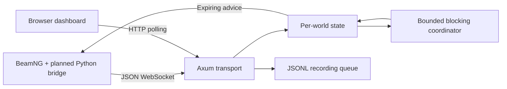

# Current architecture

## Current Uriel design beyond the prototype

S5 adds a planned Python arrival-time inference worker on LinuxONE alongside Rust, and training/data collection on LinuxONE or an approved host. BeamNG and Python bridges remain on Fedora laptops. Browser observation stays separate from server computation. No ML worker, bridge or training pipeline has been established in this workspace. `server/`, `bridge/`, `ml/`, `dashboard/`, `load/`, `tests/` and `docs/` are proposed repository areas, not the current layout.

The existing modules below describe the historical Arc Angel prototype. Its submission eligibility is unresolved under the newly reported event rule. See [[ml-arrival-prediction]] and [[context-reconciliation]]. Source: [[sources]] S5 sections 6, 13.

| File | Responsibility |
|---|---|
| `src/main.rs` | Startup, routes, WebSocket ownership, message handling, workers and recording |
| `src/protocol.rs` | Typed incoming/outgoing messages and vehicle validation |
| `src/scenario.rs` | One scenario loader and nearest-polyline projection |
| `src/world.rs` | Session state, pending frame, reservations and dashboard snapshot |
| `src/coordinator.rs` | Simplified reservation scheduling and headway caps |
| `web/` | Browser template and local demo data |

A mutex-protected registry maps world IDs to individual mutex-protected worlds. A global semaphore permits four concurrent blocking computations. Each world runs one calculation while keeping the latest pending complete frame; overwriting a pending frame increments its coalescing count.

Worlds survive a disconnect in server memory. A same-epoch reconnect gets a new session and copies previous vehicles/reservations/first-seen data. A new epoch creates fresh state. A process restart loses all world state.

Results are discarded if their session or frame no longer matches the inspected world object. Old disconnected objects and output queues require further lifecycle review; a frame match alone does not enforce wall freshness.

The proposed separate transport/prediction/metrics modules and dashboard WebSocket were not implemented as separate components.

## Sources

- [[sources]]: S3 static inspection; [main.rs](../../../../src/main.rs), [world.rs](../../../../src/world.rs).
- Related: [[protocol]], [[coordination]], [[implementation-status]].
