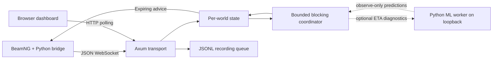

# Current architecture

## Current Uriel design beyond the prototype

The optional newline-delimited JSON worker client is integrated into crossing-v1, with observe-only as the default and an explicit hybrid mode. The trained portable model and Rust/Python worker were deployed on LinuxONE; ten remote HTTP conflict-evaluation calls returned accepted results. The user also reports that a teammate successfully ran the IBM-hosted server version. BeamNG and its Python bridge run on the development laptop; our live vehicle trial used local coordination because SSH-tunnel latency exceeded its deadlines. The worker deployment does not establish that the laptop completed live BeamNG control remotely. `server/`, `bridge/`, `ml/`, `dashboard/`, `load/` and `docs/` remain proposed areas, not a description of the current layout.

The existing modules below describe the historical Arc Angel prototype. Its submission eligibility is unresolved under the newly reported event rule. See [[ml-arrival-prediction]] and [[context-reconciliation]]. Source: [[sources]] S5 sections 6, 13.

| File | Responsibility |
|---|---|
| `src/main.rs` | Startup, routes, WebSocket ownership, message handling, workers and recording |
| `src/protocol.rs` | Typed incoming/outgoing messages and vehicle validation |
| `src/scenario.rs` | One scenario loader and nearest-polyline projection |
| `src/world.rs` | Session state, pending frame, reservations and dashboard snapshot |
| `src/coordinator.rs` | Simplified reservation scheduling and headway caps |
| `src/headon_protocol.rs` | Separate typed maneuver-v2 messages, identity, state, paths and acceptance contract |
| `src/headon.rs` | Rust-authoritative fixed paired paths, measured-state validation, acknowledgements and fresh execution leases for the bounded head-on slice |
| `src/headon_bridge.rs` | `/ws/headon` lifecycle/ownership, JSONL events and dashboard-compatible snapshots |
| `src/ml.rs` | Crossing-v1 causal feature assembly, 5 Hz speed history and bounded loopback prediction client |
| `scripts/headon_client.py` | Strict Python v2 handshake/lease/path validation and telemetry exchange |
| `scripts/ml_worker.py` | Version-checked joblib arrival/clearance inference worker; model path is supplied at startup |
| `scripts/beamng_headon.py` | BeamNG setup, origin/front alignment, one-time path application, measured telemetry and simulator pause guards |
| `web/` | Browser template and local demo data |

A mutex-protected registry maps world IDs to individual mutex-protected worlds. A global semaphore permits four concurrent blocking computations. Each world runs one calculation while keeping the latest pending complete frame; overwriting a pending frame increments its coalescing count.

Worlds survive a disconnect in server memory. A same-epoch reconnect gets a new session and copies previous vehicles/reservations/first-seen data. A new epoch creates fresh state. A process restart loses all world state.

Results are discarded if their session or frame no longer matches the inspected world object. Old disconnected objects and output queues require further lifecycle review; a frame match alone does not enforce wall freshness.

The proposed separate transport/prediction/metrics modules and dashboard WebSocket were not implemented as separate components.

The optional crossing-v1 ML path sends Rust-derived ETA features to a same-host Python worker and appends validated estimates to the returned batch; its result can affect conflict timing only when hybrid mode is enabled. Worker absence and 40 ms timeouts leave Rust-only behaviour intact. The new head-on slice follows a separate path: BeamNG → Python telemetry → Rust maneuver session → fixed paired paths and fresh leases → Python AI application. V2 does not use ML. The IBM hybrid deployment and HTTP inference were verified, while live laptop-to-BeamNG operation over the SSH tunnel exceeded controller deadlines; the head-on slice used local coordination. See [[protocol]], [[ml-arrival-prediction]] and [[operations]].

## Sources

- [[sources]]: S3 static inspection; [main.rs](../../../../src/main.rs), [world.rs](../../../../src/world.rs).
- Related: [[protocol]], [[coordination]], [[implementation-status]].
