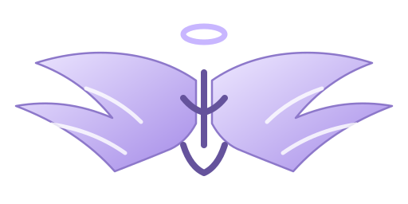
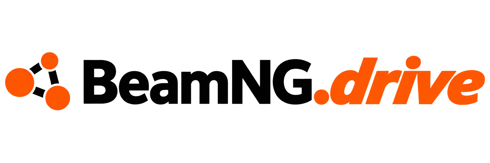

<p align="center">
  
</p>

<h1 align="center">Uriel</h1>
<p align="center"><strong>A shared AI supervisor connecting autonomous vehicles for cooperative road safety.</strong></p>

<p align="center">
  
</p>

**Uriel is a shared AI supervisor for connected autonomous vehicles.** Each vehicle has its own onboard AI for understanding its surroundings and controlling its movement. Uriel's vision is to connect those otherwise independent systems so vehicles can share their state, intentions and road hazards, anticipate conflicts together, and coordinate safer responses.

An onboard Uriel client would connect each vehicle to the shared supervisor. The supervisor combines information from participating vehicles, predicts how their movements may interact, and sends coordinated guidance back to their local AI. The vehicle retains immediate control and local fallback. The wider idea covers crossing conflicts, oncoming encounters, rear-end threats, shared hazards and coordinated responses across a road network.

**The 90-degree crossing is a small demonstration of this broader idea.** We used two vehicles in BeamNG.drive to make one cooperative decision visible: when their paths conflict, one vehicle slows so the other can pass. This prototype represents one part of the proposed supervisory system; deployment on real autonomous vehicles and the wider road-safety capabilities remain future work.

## Why IBM LinuxONE

Road-safety coordination is time critical: a useful prediction must arrive while vehicles still have time to respond. IBM LinuxONE hosts Uriel's shared Rust coordination service and ML inference worker, bringing prediction and coordination together on the server. The intended role is to handle shared information and timely decisions across connected vehicles while their onboard AI handles immediate driving. Rust provides the coordination runtime; the trained models estimate arrival and clearance timing.

The hybrid service was deployed and exercised on IBM LinuxONE; a teammate also reports a successful run using the IBM-hosted server. Our laptop-controlled BeamNG trials used local coordination because SSH-tunnel latency exceeded the controller deadlines. The recorded server inference checks and network measurements below show why both computation time and communication delay matter for this architecture.

The angel-wings mark is an original Uriel asset; the BeamNG.drive mark above is the user-provided logo.

## At a glance

| Area | What is implemented and evidenced |
| --- | --- |
| Rust coordinator | Axum/Tokio service, WebSocket bridge, reservations, conflict evaluation, and optional hybrid arrival-time inference |
| BeamNG.drive | Python tooling for telemetry, route experiments, head-on avoidance, and a matched 90-degree crossing comparison |
| Machine learning | GPU-trained XGBoost entry and clearance models; a Python worker, Rust integration, portable LinuxONE inference, and recorded grouped evaluation |
| Dashboard | Browser dashboard for live telemetry plus selectable synthetic head-on and 90-degree demos |
| Tests recorded | 38 Rust tests and 4 ML-worker Python tests passed for the hybrid integration; additional focused checks and BeamNG runs are listed below |
| Deployment | LinuxONE hybrid service and HTTP inference were verified, with a successful teammate-reported IBM-hosted run; laptop-to-server latency prevented the BeamNG controller from running its trial remotely |

## Small demonstration in BeamNG.drive

BeamNG.drive lets us demonstrate the shared-supervisor concept with controlled, repeatable vehicle encounters. For this demo, we selected a 90-degree crossing with two matching Vivace cars on perpendicular routes in Small Grid. The experiment asks whether shared prediction and coordination can make one vehicle yield when both would otherwise enter the same space:

| Trial | Setup | Recorded outcome |
| --- | --- | --- |
| Uncoordinated baseline | Both cars targeted 8 m/s; native car avoidance disabled | Stopped after 7.4 simulation seconds on the damage guard; damage readings 4,175.430 and 4,203.463; minimum sampled reference-point separation 2.905 m |
| Uriel hybrid | Local Rust coordinator and ML worker; red yielded while blue crossed | Both cars cleared after 14.4 simulation seconds; zero reported damage; minimum sampled reference-point separation 25.322 m |

This is one paired demonstration (two trials) in one simulator setup. Damage is a proxy and contact attribution was unavailable. It demonstrates the observed behavior for this setup; it is not a general collision-prevention guarantee or a certified safety result. The run evidence is recorded under `runs/grid-comparison-62ce5ba2fe/` when available locally.

A separate local hybrid pass also recorded both cars clearing with zero reported damage. Two head-on avoidance pairs (four trials total) recorded `passed_and_returned` with zero reported damage in each run. These are bounded demonstrations; the exact route, controller, and conditions matter. The project also recorded West Coast USA route and vehicle experiments, but those route/clearance labels are provisional and are not interchangeable with the marked Small Grid crossing.

## Training data and evaluation

The combined training run used teammate-provided Downloads data and local recordings on the laptop RTX 4060 GPU (`cuda:0`). The audit accepted **52 Small Grid trial folders** (50 teammate-provided and 2 local) plus **27 exploratory West Coast trials** as source folders. Incomplete, damaged, incompatible, and duplicate records were excluded as appropriate for each target.

| Target | Training examples | Independent groups | Held-out evaluation |
| --- | ---: | ---: | --- |
| Entry time | 8,073 | 22 | 2,256 rows across 23 trials and 5 groups; MAE 0.369 s, p95 absolute error 1.442 s |
| Rear-clearance time | 7,568 | 18 | 2,200 rows across 18 trials and 5 groups; MAE 0.438 s, p95 absolute error 1.954 s |

These are grouped held-out regression metrics, not collision-avoidance scores. The final models are XGBoost UBJ files under `runs/ml-arrival/combined-gpu-cf2bc118ec/models/` when the local training artifacts are present. The hybrid path loads those models in a Python worker and can use estimates to widen the crossing occupancy window while retaining Rust’s physical checks. The learned two-second allowance and West Coast labels are experimental; model calibration, missing-feature behavior, and broader scenario validation remain open. Point clouds were not used for this training run.

## Validation recorded

- **38 Rust tests passed.**
- **4 Python ML-worker tests passed.**
- An isolated local integration loaded the trained models and received ten model-bearing Rust crossing responses; maximum measured local round trip was 2.20 ms.
- Ten remote HTTP conflict-evaluation calls through the deployed LinuxONE service returned accepted monitor results; maximum measured remote-local elapsed time was 4.97 ms. The LinuxONE health endpoint returned `ok` and both user services were active.
- A portable inference export matched XGBoost on 500 finite and missing-value inputs.
- Three laptop HTTP health checks through the SSH tunnel took 1.95–2.81 seconds. That exceeds the bridge’s 350 ms request and 500 ms plan-lease limits, so the laptop BeamNG controller used local coordination. This network limitation does not mean the IBM server was untested: the deployed LinuxONE hybrid service passed HTTP inference checks, and a teammate reports a successful IBM-hosted run.

Counts above describe the named verification runs in the project record; they are not a claim that every test in the repository was run in one suite. The dashboard’s two selectable demos are synthetic previews, separate from BeamNG measurements.

## Quick start

### Prerequisites

- Rust toolchain and Cargo (Rust 2021 edition).
- Python dependencies from `requirements-beamng.txt` for BeamNG scripts.
- BeamNG.tech/BeamNG.drive with its API enabled for live simulator experiments.
- A browser for the dashboard.

### Run the local service

```sh
cargo run
```

Open [http://127.0.0.1:3000](http://127.0.0.1:3000). The bridge endpoint is `ws://127.0.0.1:3000/ws/bridge`. The project’s live demonstration scripts and their options are documented in `scripts/BEAMNG_RECORDING.md` and `scripts/ARRIVAL_HYBRID.md`.

### Environment variables

| Variable | Default | Purpose |
| --- | --- | --- |
| `ARC_BIND` | `127.0.0.1:3000` | HTTP and WebSocket listen address |
| `ARC_SCENARIO` | `scenarios/crossing-v1.json` | Scenario configuration |
| `ARC_RUN_DIR` | `runs` | Local experiment record directory |
| `ARC_TOKEN` | Unset | Optional bridge Bearer token |
| `ARC_ML_ADDR` | Unset | Optional same-host ML worker address |
| `ARC_ML_MODE` | Observe-only/default | Set to `hybrid` to opt into experimental learned timing |
| `RUST_LOG` | `arc_angel=info` | Log filter |

Keep the default localhost binding for local development. Do not expose the ML worker port publicly. The optional bridge token does not authenticate browser observation endpoints.

## Dashboard and API

The dashboard polls the Rust service for world and vehicle state. Its **Preview demo** control switches between synthetic head-on and 90-degree illustrations; these do not command BeamNG vehicles. The live observer is display-only.

| Endpoint | Purpose |
| --- | --- |
| `/health` | Service health |
| `/api/status` | Server status |
| `/api/worlds` | Available worlds |
| `/api/worlds/{id}` | World details |
| `/api/scenarios/{id}` | Scenario details |
| `/api/conflicts/evaluate` | Conflict assessment; hybrid estimates are optional and experimental |
| `/ws/bridge` | Vehicle state and recommendation exchange |

## Repository map

| Path | Contents |
| --- | --- |
| `src/` | Rust service, protocol, coordination, conflict evaluation, and ML client |
| `web/` | Browser dashboard and synthetic demos |
| `scripts/` | BeamNG experiment runners, data audit/training, and ML worker |
| `scenarios/` | Scenario configurations and saved route exports |
| `examples/` | Protocol and API examples |
| `assets/` | Uriel angel-wings SVG and supplied BeamNG.drive logo |
| `AI-Wiki/Projects/IBM/wiki/` | Requirements, architecture, evidence, operations, and team workflow |
| `runs/` | Local experiment evidence and model artifacts (ignored by Git) |

## Limits

- BeamNG results cover specific scripted scenarios and controller settings; they do not establish general collision prevention.
- West Coast USA geometry and arrival/clearance labels remain provisional.
- ML evaluation is grouped regression evaluation, not end-to-end safety evaluation.
- Some runtime observations lack model features such as history, object height, and nearest-vehicle measurements.
- The remote service is deployed and inference was verified, but tunnel latency exceeds the bridge’s control deadline for live remote BeamNG driving.
- Recommendations are advisory. Physical braking envelopes, route conflict geometry, uncertainty handling, and fault behavior need broader validation.

## Project documentation

Start with the [project wiki](AI-Wiki/Projects/IBM/wiki/index.md):

- [Latest requirements](AI-Wiki/Projects/IBM/wiki/latest-prd-context.md)
- [Implementation status and evidence](AI-Wiki/Projects/IBM/wiki/implementation-status.md)
- [ML data and evaluation](AI-Wiki/Projects/IBM/wiki/ml-arrival-prediction.md)
- [BeamNG operations](AI-Wiki/Projects/IBM/wiki/operations.md)
- [Team workflow](AI-Wiki/Projects/IBM/wiki/team-workflow.md)

Open `AI-Wiki/` as an Obsidian vault for linked navigation. AI assistants should read `AGENTS.md` and `.agents/skills/uriel/SKILL.md`, then update the wiki and chronological log after meaningful project work.
